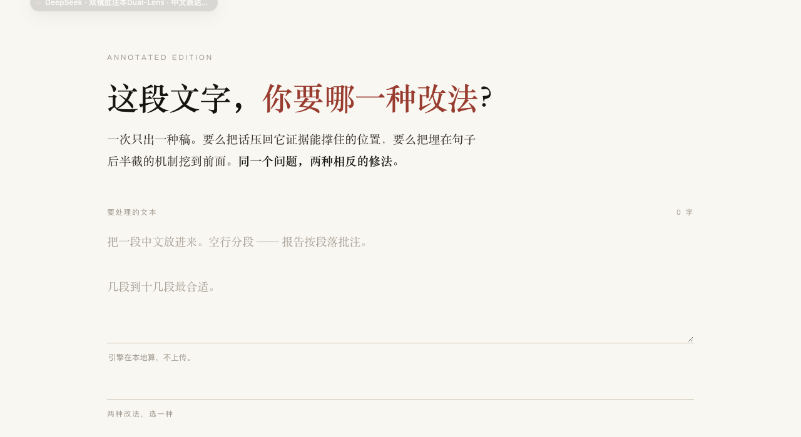

# 双镜批注本 · zh-sci-lens

把一个中文句子拆开，看看它的**确定性**和它**手里握着的证据**是否匹配。

两种改法，方向相反，各出一份独立的稿子：

| 改法 | 对着什么文本 | 做什么 |
|---|---|---|
| **严谨化** rig | 说得很大、把「理论上可能」讲成「已经发生」的科普 | 把断言压回证据能撑住的位置：该加条件的加条件，该降级的降级，该删的删。不改知识。 |
| **通俗化** pop | 术语先出场、机制被塞进后置定语、每段都在堆情绪的科普 | 让一个完全不懂这个专业的人读完能自己复述一遍。把「为什么」提到前面，名词换成动作，删掉重复的情绪升级。不改事实。 |

输出不是一段改写，是一份**批注本**：原文逐段排出，有问题的地方用灰色粗体斜体标出来、右上角挂编号，右侧页边注写明「这里为什么不对、应该改成什么」；后面接完整改写、内容总结、事实核对、以及一份「中文为什么容易把话说满」的学习建议。

**[▶ 直接打开单文件版](https://driedpenguin29.github.io/zh-sci-lens/)**（GitHub Pages，点开就能贴文本）



---

## 三种形态，用哪个都行

### 1. 单文件版（推荐先试这个）

[`standalone/双镜批注本.html`](standalone/双镜批注本.html) —— 双击打开，零依赖、零安装、不联网。

它自己会在本地算指标（引擎内联在页面里），但**不调模型**。报告由你的 agent 写：

1. 贴文本 → 选「严谨化」或「通俗化」→ 页面给出一份**任务包**，复制给任意 agent（Claude、Codex、WorkBuddy、DSH 都行）；
2. agent 按契约回一段 JSON，粘回页面右侧，报告当场排出来；
3. 或者把 JSON 直接给 agent，让它把 `window.REPORT = {…}` 烤进 HTML，交付一份打开即报告的成品。

> 附带一个烤好的样例：[`standalone/预览-柔性钙钛矿.html`](standalone/预览-柔性钙钛矿.html)

### 2. DSH 侧边栏插件

[`dsh-plugin/`](dsh-plugin/) —— 装进 DeepSeek Harness 后，左侧栏多一个「双镜批注本」，点开就是输入框，贴文本、选改法，模型在宿主里跑，报告直接排出来，可导出 HTML / Markdown。

```bash
# 用 DSH 的 plugin_manager 安装（路径换成本仓库 clone 下来的 dsh-plugin 目录）
plugin_manager install_bundle --target /path/to/zh-sci-lens/dsh-plugin
```

它用宿主自己的模型（`ctx.llm`）和默认模型选择，不需要另配 API key。

### 3. 通用 agent skill

[`skill/`](skill/) —— 一个纯文本 skill 包（`SKILL.md` + 引擎 + 模板 + 示例），给任何会读 skill 的 agent 用：放进 `~/.dsh/skills/`、`~/.workbuddy/skills/`、`~/.codex/skills/` 都能直接生效。

```
skill/
├── SKILL.md                  工作流：读入 → 测量 → 定位 → 查证 → 改写 → 出页面
├── core/zh_sci_lens.py       判定引擎，零第三方依赖（re / math / json / argparse / sys）
├── core/render.py            参数化渲染器：spec.json + templates/ → 单文件 HTML
├── core/controls.md          14 个润色控件（6 个可正则执行，8 个需要模型）
├── templates/standalone.html 上面那个单文件版（同一份实现）
├── references/               各字段契约、闸门阈值、宿主适配
└── examples/                 两篇验收夹具：白洞（rig）、鞭毛马达（pop）
```

自带自检：`bash skill/verify.sh` → 全绿。

---

## 它怎么判断一段话有病

引擎只做测量，不下结论；判断由模型写。这些是可复现的量（`core/zh_sci_lens.py`）：

| 指标 | 说明 | 阈值 |
|---|---|---|
| 断言强度 | 绝对化 + 情绪词 − 限定语，按千字归一 | ≤ 8 |
| 可读分 | 跟随词 + 连接词 + 句长可控 + 换气短句 | ≥ 60 |
| 趣味分 | 悬念句 / 提问 / 具体锚点 / 对话感，四种**可数结构**，不是词表 | ≥ 50 |
| 句长变异 | 句长的标准差 / 均值 | 0.25–0.45 |
| 破折号 | 每千字 | 0（标题里的分隔线不算） |
| 情绪词 | 每千字 | ≤ 3 |

两个模式用同一套量，判定公式见 `skill/references/gates.md`。

**验收看增量，不看绝对分**：一段本身不难的文本，可读分可能一开始就有 60，改完还是 60——那不算成功，要看你把最弱的那一项推上去多少。

## 一条踩出来的经验

「可读性」和「趣味性」**不能靠删产生**。

机械替换能把破折号清零、把长句拆短、把 AI 词删掉，但删完可读分和趣味分常常一分不涨——因为它们的分来自「有没有把读者拉进来的东西」（提问、具体的人和时间地点、短句收尾），而那些只能加，不能删。

所以 14 个控件分两档：6 个正则可执行，8 个必须模型动手。页面会如实标出来，不假装全能。

## 已知的边界

- **单文件版不调模型**。它算指标、排报告，但报告的内容质量取决于给它写 JSON 的那个 agent。
- **事实核对不是查证**。它标的是「这句话的确定性超过它手里的证据」，不是「这句话在事实上是错的」；要查事实得自己去查文献。
- **严谨化会牺牲一部分趣味**。对话感是趣味分里权重最大的一项，而删掉「你」正是严谨化的常用手段——这份损失是真的，报告里会写出来，不粉饰。
- **中文去 AI 味词表是启发式的**。覆盖的是常见模板腔，不是检测器。

## 许可

MIT（见 [`LICENSE`](LICENSE)）。插件 manifest 里本来写的也是 MIT，两处保持一致。

## 参考

视觉上参照了 Blackboard Ultra 的排版语汇（灰码 / 黑标题 / 蓝链接 / 细分隔线），最终落成的是一份**校对稿**的样子：宋体正文、朱红批注、页边注在右栏——不做卡片墙。
